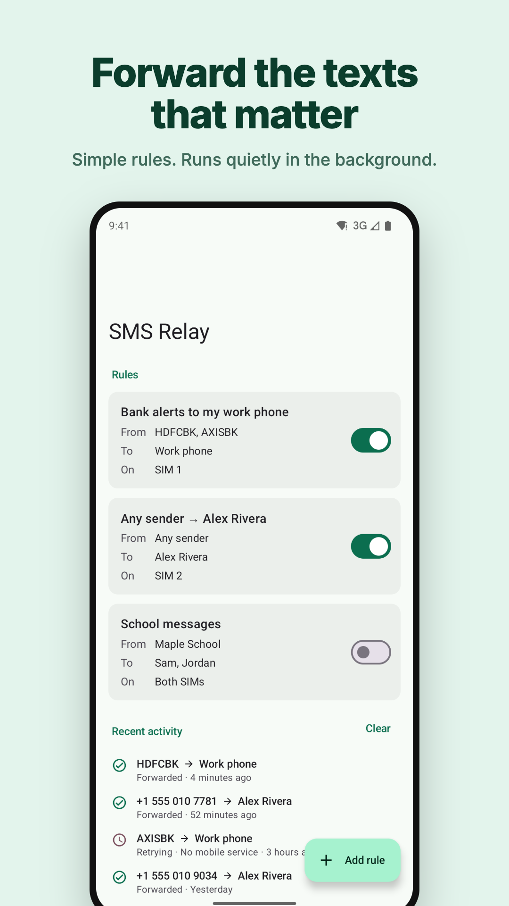
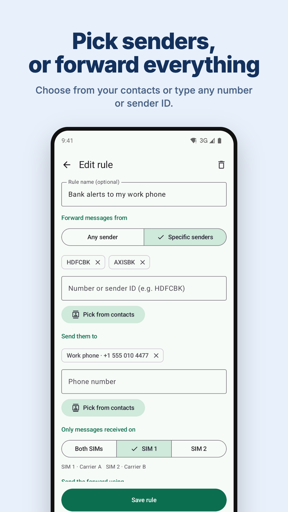
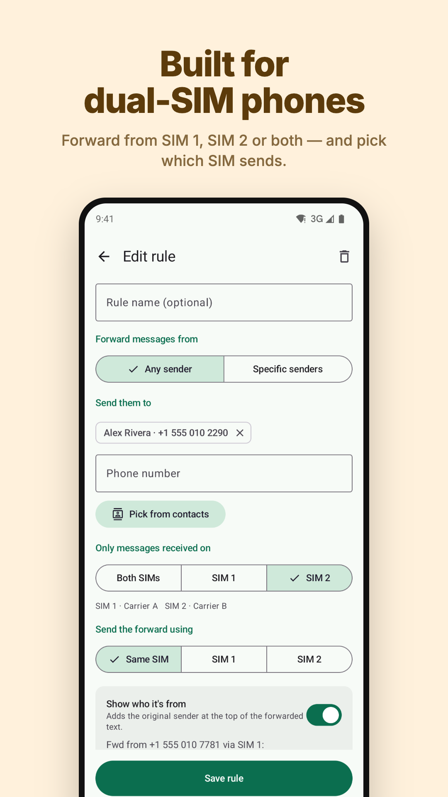

# SMS Relay

Forward the text messages you choose to another phone. Rules are simple — *from these senders (or anyone), on this SIM, to these numbers* — and everything happens on the phone. No internet permission, no account, no tracking.

<p>



</p>

- Forward from specific numbers / sender IDs (e.g. `HDFCBK`), or from everyone
- One or many recipients; pick from your contacts app or type numbers
- Dual-SIM: filter by SIM 1 / SIM 2 / both and choose the sending SIM
- Long messages forwarded in full; automatic retries; activity log
- Loop protection (never forwards back to the sender, ignores its own forwards)

Website, privacy policy and terms: <https://ajay-develops.github.io/sms-relay/>

## Install

- Google Play: `com.soulredemption.smsrelay`
- APK: [GitHub Releases](https://github.com/ajay-develops/sms-relay/releases/latest)

If you install the APK directly and Android says the SMS permission is restricted, open **App info → ⋮ → Allow restricted settings**, then grant it.

## Permissions

| Permission | Why |
|---|---|
| `RECEIVE_SMS` | Detect incoming messages |
| `SEND_SMS` | Send the forwarded copy |
| `READ_PHONE_STATE` | Tell SIMs apart; send from a chosen SIM |
| `POST_NOTIFICATIONS` | Optional alert when a forward fails |

Contacts are chosen with the system picker, which shares only the picked contact — no `READ_CONTACTS`. `INTERNET` is explicitly removed from the manifest.

## Build

Requires JDK 17 and the Android SDK (API 36).

```bash
./gradlew testDebugUnitTest assembleDebug
```

Release signing reads `~/.config/sms-relay/signing.properties` (or the path in `SMS_RELAY_SIGNING_PROPERTIES`) with `storeFile`, `storePassword`, `keyAlias`, `keyPassword`. Without it, `assembleRelease` produces an unsigned APK.

Debug builds accept extras used to capture store screenshots: `--ez demo true --ez dual_sim true --ez brand_colors true`. Store graphics are rendered with `python3 store/src/render.py`.

## Project layout

```
app/src/main/java/com/soulredemption/smsrelay/
  data/   Rule & log models, JSON store, matching logic (unit tested)
  sms/    SMS receiver, forwarder, send-status receiver, retry worker, SIM helpers
  ui/     Compose screens: setup, rules list, rule editor
docs/     Website (GitHub Pages): landing page, privacy policy, terms
fastlane/ Store listing text and images (used by F-Droid)
```

## License

GPL-3.0-or-later © 2026 Saul Redemption Services LLC
